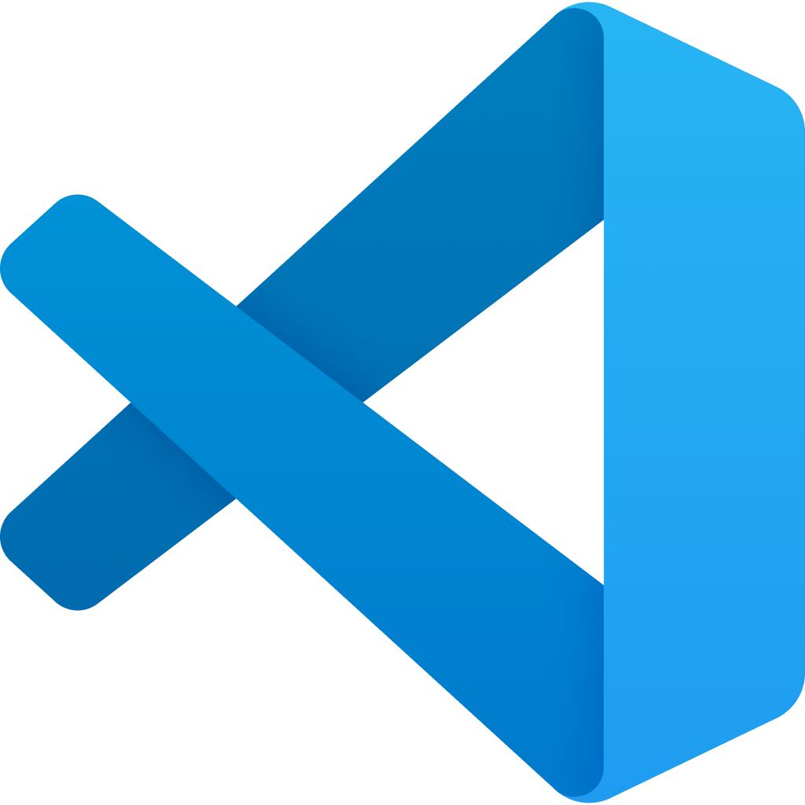
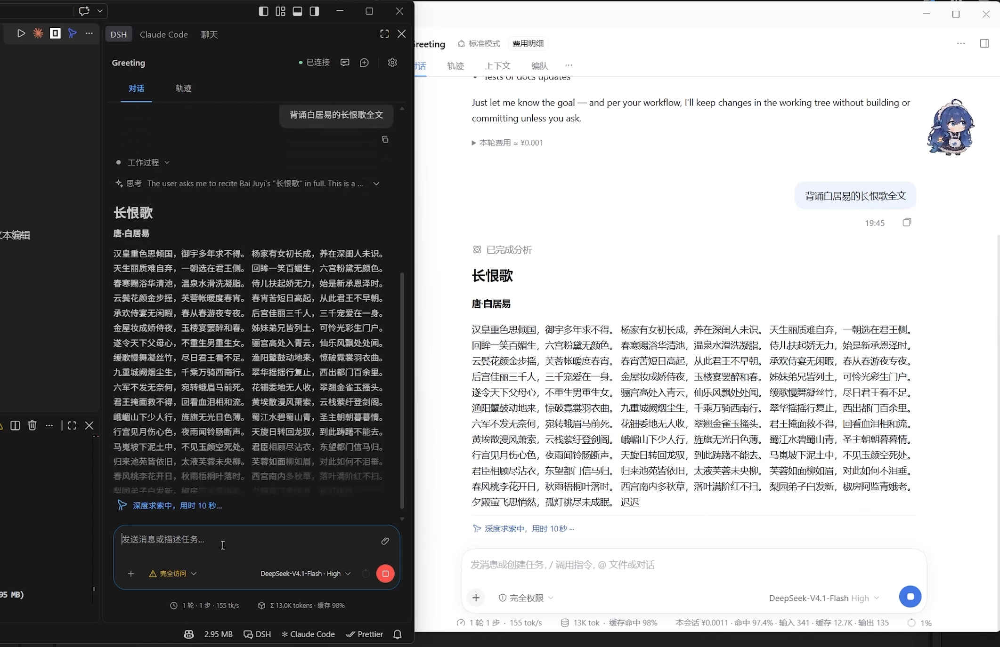

<p align="center">
  
</p>

<h1 align="center">DSH VS Code Connect</h1>

<p align="center"><strong>Continue the same session in DSH Desktop and VS Code</strong></p>

<p align="center">
  <a href="#quick-start">Quick start</a> ·
  <a href="#connect-manually">Connect manually</a> ·
  <a href="https://github.com/mcdottok/vscode-dsh/releases">Download the VS Code extension</a> ·
  <a href="README.md">简体中文</a>
</p>

Install this companion plugin in DSH Desktop (DeepSeek Harness) and use it with [DSH Coding Agent](https://github.com/mcdottok/vscode-dsh) in VS Code. Open the same workspace and session in both apps to continue discussing your project or reviewing code.



## Quick start

1. **Install the connector in DSH Desktop.** Open **Plugins → Add plugin** and enter `dsh-vscode-connect@latest`. Install and enable the plugin, then keep Desktop running. **VS Code connection** is enabled by default on a fresh install.
2. **Install DSH Coding Agent in VS Code.** Download the `.vsix` from [GitHub Releases](https://github.com/mcdottok/vscode-dsh/releases). In the VS Code Extensions view, choose **… → Install from VSIX…** and select the downloaded file.
3. **Connect to Desktop.** Open and trust your project folder, then select **DSH Desktop** under **Settings → Connection** in the DSH panel. If both apps run on the same Windows PC, choose **Connect to Desktop** to try automatic connection. On other platforms, or if automatic connection fails, follow the manual steps below. Once connected, open the same workspace and session as in Desktop.

You can keep browser access disabled and continue using your current Desktop layout.

## Connect manually

1. In Desktop, open **Settings → General → VS Code connection**. Enable the switch if it is off.
2. Choose **Copy connection address**. Keep this address private because it contains credentials.
3. From the VS Code Command Palette, run **DSH: Connect to Desktop** and paste the address.

Saved manual settings take precedence over automatic discovery. Turning off **VS Code connection** in Desktop closes the dedicated connection and stops automatic discovery.

## Common questions

- **Does “ready” in Desktop mean I am connected?** It means Desktop can accept connections. Check the DSH panel in VS Code for the actual connection status.
- **What if I cannot connect or reconnect?** Make sure Desktop is running, both plugins are enabled, and **VS Code connection** is on in Desktop. If needed, copy the current address and connect manually again.
- **Do I need this plugin in DSH CLI mode?** The **DSH CLI** mode in DSH Coding Agent starts a separate service and can run on its own. If another instance already holds a session, close the session there, start a new one, or switch to **DSH Desktop** mode to resume the original session.

## Other installation methods

The connector is also available from [npm](https://www.npmjs.com/package/dsh-vscode-connect). To install from a local file, download a `.tgz` from [GitHub Releases](https://github.com/mcdottok/dsh-vscode-connect/releases). If your npm mirror has yet to sync the package, try the official registry.

### Install the connector from the DSH CLI

For the `web` profile in DSH Web / CLI:

```sh
dsh plugin --profile web add dsh-vscode-connect@latest
```

For the `desktop` profile, use **the CLI bundled with the target Desktop installation**:

```sh
dsh plugin --profile desktop add dsh-vscode-connect@latest
```

### Install the VS Code extension from the command line

Run this in the download directory, replacing the filename with the VSIX you downloaded:

```sh
code --install-extension "./<downloaded-filename>.vsix"
```

## Compatibility and development

See [`engines.dsh` in `package.json`](package.json) for the supported installation range. Desktop behavior with newer runtimes still needs verification.

```sh
npm ci --ignore-scripts
npm test
```

On Windows, run `.\build.cmd` to write the package to `artifacts/`. You can also run `npm run build`, create `artifacts/`, and run `npm pack --ignore-scripts --pack-destination artifacts`.

See the [changelog](CHANGELOG.md), [contributing guide](CONTRIBUTING.md), and [lifecycle checks](reviews/memory-lifecycle.md) for details.

## License

This independent community project uses the [MIT license](LICENSE). See the [third-party notices](THIRD_PARTY_NOTICES.txt) for DeepSeek-derived code and dependency attribution.
