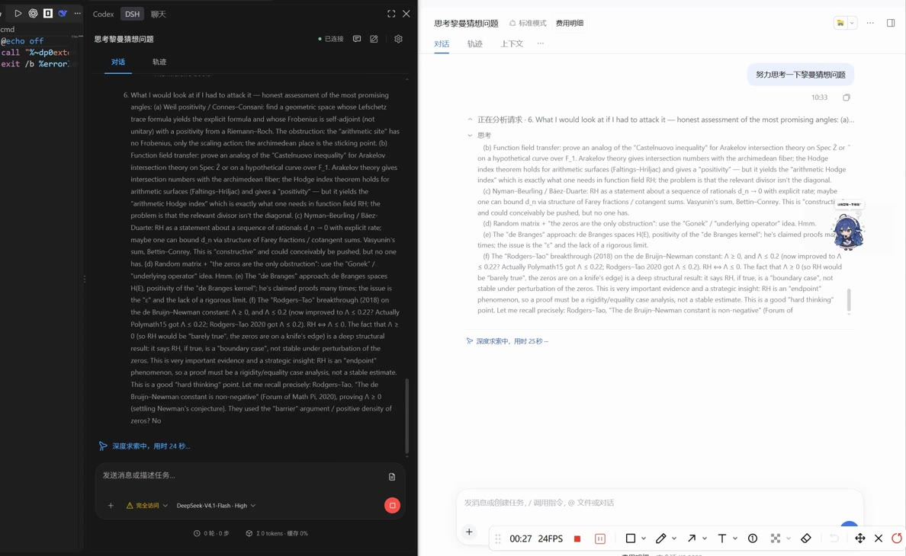

# DSH VS Code Connect

[简体中文](README.md) | [English](README.en.md)

让 DeepSeek Harness / DSH Desktop 与配套的 [DSH for VS Code](https://github.com/mcdottok/vscode-dsh) 扩展连接，在编辑器中接续同一会话，提供类似 Codex、Claude Code 的 VS Code 插件体验。

## 演示

[](docs/assets/demo.mp4)

[查看演示视频](docs/assets/demo.mp4)

## 安装即连接

连接需要两端配合：**本插件安装在 DeepSeek Harness / DSH Desktop 中，配套扩展安装在 VS Code 中**。

在 **DeepSeek Harness / DSH Desktop → 插件 → 添加插件** 中填写下面的包名，点击「安装」即可，无需先下载文件：

```text
dsh-vscode-connect@latest
```

1. 安装后启用插件并保持桌面端运行。首次安装默认开启 **VS Code 连接**。
2. 从 [DSH for VS Code Releases](https://github.com/mcdottok/vscode-dsh/releases) 下载 `.vsix`，在 VS Code 中通过 **扩展：从 VSIX 安装…** 安装，打开并信任项目文件夹。
3. Windows 同机环境下自动发现并连接；选择同一工作区和已有会话，即可继续开发。

无需开启桌面端浏览器访问，也无需切换桌面布局。曾手动关闭连接的设置会保留，可在 **设置 → 通用设置 → VS Code 连接** 重新开启。

插件已发布到 [npm](https://www.npmjs.com/package/dsh-vscode-connect)。也可从 [GitHub Releases](https://github.com/mcdottok/dsh-vscode-connect/releases) 下载 `.tgz`，通过本地文件安装。若镜像源暂时找不到包，可切换官方 npm 源重试。

### 命令行安装（从 npm 获取）

如果使用 DSH Web / CLI，可执行：

```powershell
dsh plugin --profile web add dsh-vscode-connect@latest
```

如果操作桌面端的 `desktop` profile，使用**该桌面端自带的 DSH CLI** 执行：

```powershell
dsh plugin --profile desktop add dsh-vscode-connect@latest
```

操作 `desktop` profile 时，`dsh` 应指向目标桌面端随附的 CLI，不要用其他版本的全局 DSH 命令修改桌面端 profile。桌面用户也可以直接使用前面的「添加插件」入口。

包由 npm 提供，`dsh plugin` 负责安装到对应 profile 并注册插件。

## 手动连接与管理

其他平台、远程环境或自动连接不可用时，在桌面端 **设置 → 通用设置 → VS Code 连接** 中点击 **复制连接地址**，然后在 VS Code 执行 **DSH: Connect to Desktop / 连接桌面端** 并粘贴地址。已有手动配置优先于自动发现。

连接地址含凭据，请勿分享。自动连接当前仅支持 Windows 本机，凭据由 Windows 账户加密与 VS Code SecretStorage 保护。关闭连接开关会停止专用连接和自动发现。

## 开发与兼容

```powershell
npm ci --ignore-scripts
npm test
```

Windows 可运行 `.\build.cmd` 构建并打包到 `artifacts/`。独立命令为 `npm run build`，然后创建 `artifacts/` 并运行 `npm pack --ignore-scripts --pack-destination artifacts`。构建不需要旁边的扩展仓库。

兼容声明以 `package.json` 的 `engines.dsh` 为准；声明的内核版本不等于全部现场交互均已验收。见[更新日志](CHANGELOG.md)、[贡献指南](CONTRIBUTING.md)和[生命周期检查记录](reviews/memory-lifecycle.md)。

## 许可

MIT。DeepSeek 派生代码及依赖署名见 [第三方声明](THIRD_PARTY_NOTICES.txt)。本项目由社区独立维护。
