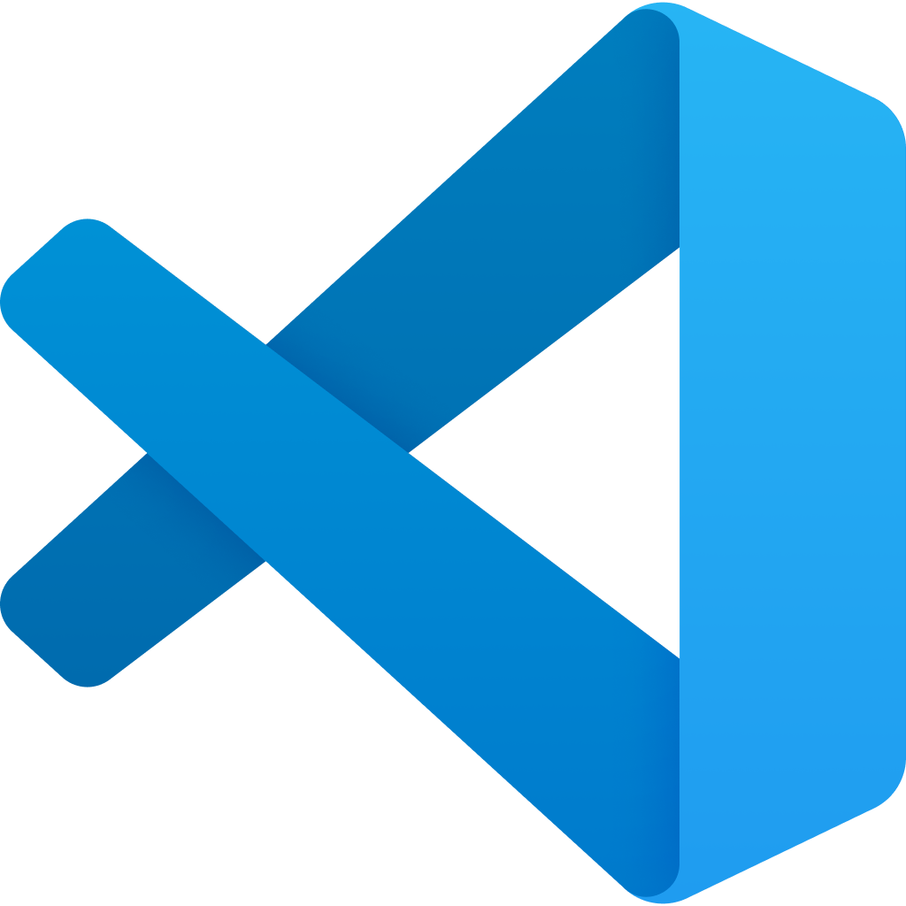
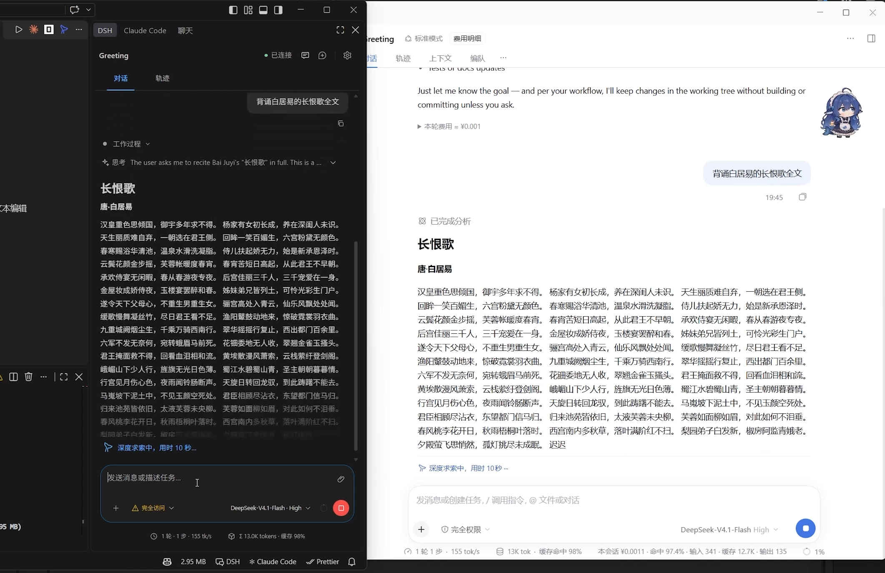

<p align="center">
  
</p>

<h1 align="center">DSH VS Code Connect</h1>

<p align="center"><strong>在 DSH Desktop 和 VS Code 之间接续同一会话</strong></p>

<p align="center">
  <a href="#快速开始">快速开始</a> ·
  <a href="#手动连接">手动连接</a> ·
  <a href="https://github.com/mcdottok/vscode-dsh/releases">下载 VS Code 扩展</a> ·
  <a href="README.en.md">English</a>
</p>

这是安装在 DSH Desktop（DeepSeek Harness）里的连接插件。与 VS Code 中的 [DSH Coding Agent](https://github.com/mcdottok/vscode-dsh) 配合使用，可以在两个应用中打开同一工作区和会话，接着讨论项目或审阅代码。



## 快速开始

1. **在 DSH Desktop 安装连接插件。** 打开 **插件 → 添加插件**，输入 `dsh-vscode-connect@latest`。安装并启用插件后，保持桌面端运行。首次安装默认开启 **VS Code 连接**。
2. **在 VS Code 安装 DSH Coding Agent。** 从 [GitHub Releases](https://github.com/mcdottok/vscode-dsh/releases) 下载 `.vsix`，在 VS Code 的扩展视图中选择 **… → 从 VSIX 安装…**，打开下载的文件。
3. **连接桌面端。** 打开并信任项目文件夹，在 DSH 面板的 **设置 → 连接** 中选择 **DSH Desktop**。两端运行在同一台 Windows 电脑上时，点击 **连接桌面端** 即可尝试自动连接。其他平台或自动连接失败时，按下方步骤手动连接。连接成功后，打开与桌面端相同的工作区和会话。

连接时无需开启桌面端的浏览器访问，也无需切换桌面布局。

## 手动连接

1. 在桌面端打开 **设置 → 通用设置 → VS Code 连接**。如果开关已关闭，先打开。
2. 点击 **复制连接地址**。地址包含凭据，请勿分享。
3. 在 VS Code 命令面板执行 **DSH: 连接桌面端**，粘贴刚复制的地址。

已保存的手动配置优先于自动发现。关闭桌面端的 **VS Code 连接** 会断开专用连接并停止自动发现。

## 常见问题

- **桌面端显示「已就绪」，是否已经连上？** 这表示桌面端可以接受连接。实际连接状态请在 VS Code 的 DSH 面板查看。
- **连不上或断线后无法恢复？** 确认桌面端仍在运行、两端的插件均已启用，并检查桌面端的 **VS Code 连接** 开关。需要时重新复制最新地址，走一次手动连接。
- **使用 DSH CLI 模式需要装这个插件吗？** DSH Coding Agent 的 **DSH CLI** 模式会启动独立服务，可单独使用。如果同一会话已被另一个实例占用，可以在另一端关闭该会话、新建会话，或切换到 **DSH Desktop** 模式接续原会话。

## 其他安装方式

连接插件也可从 [npm](https://www.npmjs.com/package/dsh-vscode-connect) 安装，或从 [GitHub Releases](https://github.com/mcdottok/dsh-vscode-connect/releases) 下载 `.tgz`，在 DSH 中通过本地文件安装。npm 镜像尚未同步时，可以切换到官方源重试。

### 使用 DSH CLI 安装连接插件

DSH Web / CLI 的 `web` profile：

```sh
dsh plugin --profile web add dsh-vscode-connect@latest
```

桌面端的 `desktop` profile。请使用**目标桌面端随附的 DSH CLI**：

```sh
dsh plugin --profile desktop add dsh-vscode-connect@latest
```

### 使用命令行安装 VS Code 扩展

在下载目录执行，将文件名替换为实际下载的 VSIX：

```sh
code --install-extension "./<下载的文件名>.vsix"
```

## 兼容性与开发

DSH 的安装兼容范围见 [`package.json` 的 `engines.dsh`](package.json)。较新的内核版本仍需验证实际桌面交互。

```sh
npm ci --ignore-scripts
npm test
```

Windows 可运行 `.\build.cmd`，将安装包输出到 `artifacts/`。也可运行 `npm run build`，创建 `artifacts/` 后执行 `npm pack --ignore-scripts --pack-destination artifacts`。

更多见[更新日志](CHANGELOG.md)、[贡献指南](CONTRIBUTING.md)和[生命周期检查记录](reviews/memory-lifecycle.md)。

## 许可证

本项目由社区独立维护，采用 [MIT 许可证](LICENSE)。DeepSeek 派生代码及依赖署名见[第三方声明](THIRD_PARTY_NOTICES.txt)。
